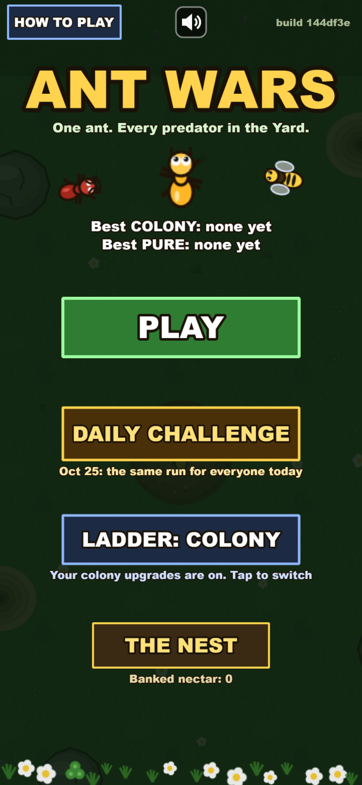
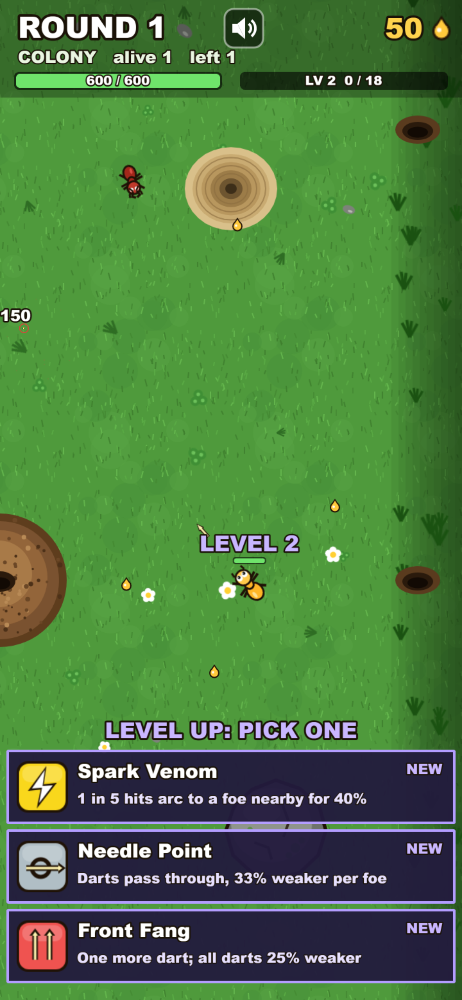
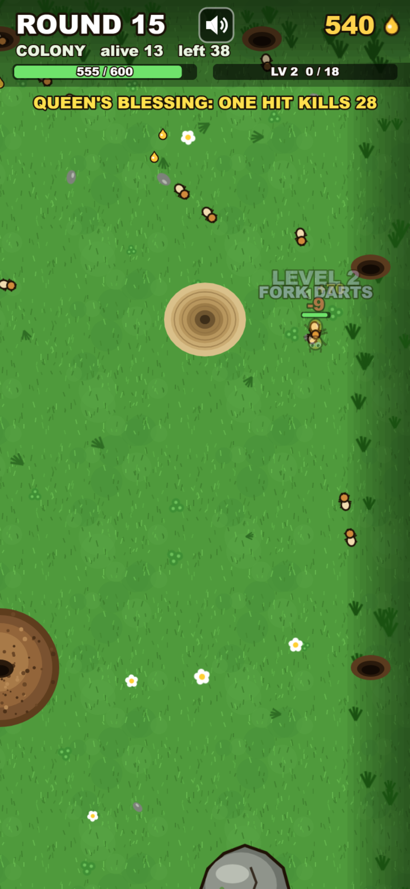
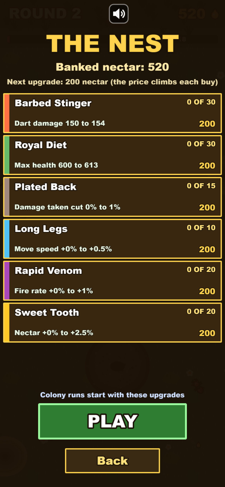

# Ant Wars

One ant with a stinger. A yard full of predators. Rounds that never end.

**Play it now:** https://antwars-yard-kti.netlify.app

Phone first. On an iPhone open the link in Safari, tap Share, then Add to Home Screen: the game opens full screen from its own icon and keeps working with no network. Android Chrome offers Install on its own. On a desktop it plays in Chrome with the mouse, WASD or the arrow keys.

<p>




</p>

## How it plays

- **Move:** touch anywhere and a stick appears under your thumb; drag to run. Lift the thumb to stand still.
- **Shoot:** automatic, at the nearest predator on screen. Standing still fires at the full rate and can crit. Moving fires at half the rate. Running away is survivable, standing still is lethal, so a chase ends with a stop and a burst.
- **Rounds:** every round sends more predators, tougher and faster, with at most 20 alive at once. Army ants from round 1, wasps from 6, spiders from 8, beetles from 12, antlions from 16, centipedes from 21. Every 5th round is a termite rush that grows each time it comes back, every 10th round brings a boss, every 25th the Anteater walks for your nest.
- **Level ups:** every kill gives experience. Each level up holds the whole yard still and offers three powers; tap one and the round carries on from the same moment. Sixteen powers so far, from Strong Jaw and Fork Darts to Frost Sap and Spark Venom, and two elements together unlock a combo.
- **Nectar and the nest:** hits and kills drop nectar. Between rounds, stand in the nest in the middle of the Yard to buy perks and repeatable upgrade lines; every buy raises the price of the next.
- **Two ladders:** Colony banks the nectar you hold when a run ends and sells permanent upgrades on the title's nest; Pure starts every run as the bare ant.
- **Daily Challenge:** one seeded run a calendar day, the same predators in the same order and the same power offers for everyone who plays it that day.
- **Runs save** at every round break. Close the app mid run and the title offers Continue.

## Run it yourself

Requirements: Node.js 22 or newer and npm.

```
cd game
npm ci
npm run dev
```

`npm run dev` prints a local address; add `--host 0.0.0.0` (`npx vite --host 0.0.0.0`) to open it from a phone on the same Wi-Fi.

| Command | What it does |
|---|---|
| `npm run build` | type check, then the production build in `game/dist/` (includes the service worker) |
| `npm test` | the vitest table tests: the round curve, the roster, the shop, the powers, the pause, the daily seed, the run save |
| `npm run smoke` | headless Chrome at an iPhone viewport plays into round 2, counts console errors and samples frame time |
| `node scripts/smoke.mjs --daily` | two fresh phones play the same day's challenge and must meet the same spawns |

Practice links: `?round=25` starts a practice run at round 25 (any round from 1 to 200), `?fps` shows the frame rate.

## Code map

- `game/src/sim/` holds the rules, each file with its table tests beside it: `curve.ts` (the round curve: counts, health, spawn gaps, the termite rushes), `roster.ts` (the predators), `economy.ts` (the ant and the shop), `pause.ts` (the one decision that holds the yard), `daily.ts` (the day's seed).
- `game/src/` holds the Phaser 3 scenes (boot, the Yard, the HUD) and the service worker source the build writes.
- `game/scripts/` holds the smoke harness (Playwright over headless Chrome) and the icon drawer.

## Status

Early. The numbers are first guesses tuned by play, the bosses have one move each, the sounds are tiny blips with no music, the art is simple shapes, and there is no store build. The open issues list what comes next.

## Contributing

Pull requests are welcome and land under the MIT licence. Keep `npm test` green, and run `npm run smoke` before a change to the scenes. Design questions go in the issues.

## Licence

MIT. Copyright (c) 2026 Alaa Soulaiman and KovaTech Industries Inc. See [LICENSE](LICENSE).
